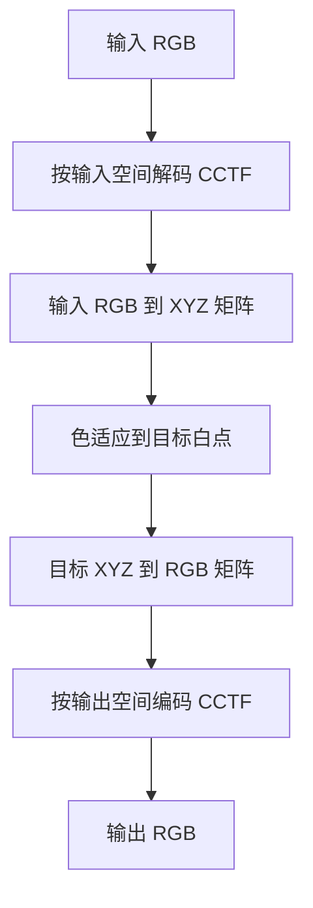

# 颜色转换

## 这个能力解决什么

颜色转换的难点不是矩阵乘法，而是**路径与语境**。同一个 RGB 三元组，在 sRGB、Display P3、ACEScg 里代表不同的物理颜色；同一个 CIE XYZ，在不同白点下需要先做色适应；同一个"红色"，在线性光与编码值之间还隔着一条传递函数。

Colour 把这些语境做成显式对象与显式路径，让调用者能选择"按哪条路走"，而不是依赖默认值猜。

## 自动转换图

转换图是一个 NetworkX 有向图：节点是颜色表示，边是转换函数。`v0.4.7` 注册了 197 条边，覆盖从光谱到外观模型的主要表示。

调用 `convert` 时，库只做四步：规范化节点名、求最短路径、逐段执行、按函数名分发参数。路径上的每一段都在域-范围尺度 `1` 下运行，所以调用者传入 `[0, 100]` 的 XYZ 时，要么打开 `from_reference_scale=True`，要么自己先除以 100。

| 调用方式 | 适合场景 | 注意 |
|---------|---------|------|
| `convert(a, source, target)` | 不确定该用哪个函数，或路径较长 | 默认按 `1` 尺度解释输入 |
| `convert(..., from_reference_scale=True)` | 输入是论文里的 `[0, 100]` 值 | 只按第一段函数的注解缩放 |
| 直接调用 `XYZ_to_Lab` 等 | 路径固定、需要精细控制参数 | 必须自己保证尺度正确 |
| `colour.graph.conversion_path(source, target)` | 想知道会走哪条路 | 返回函数列表，不执行 |

想确认路径，可以打印它：

```python
import colour

colour.describe_conversion_path("CIE Lab", "CCT")
# "Lab_to_XYZ" --> "XYZ_to_UCS" --> "UCS_to_uv" --> "uv_to_CCT"
```

## RGB 色彩空间对象

一个 RGB 色彩空间在 Colour 里不是一组常数，而是 `RGB_Colourspace` 实例。它携带五类信息：

| 字段 | 含义 | 用途 |
|------|------|------|
| `name` | 色彩空间名称 | 作为 `RGB_COLOURSPACES` 的键 |
| `primaries` | 三基色的 CIE xy 坐标 | 推导 RGB↔XYZ 矩阵 |
| `whitepoint` | 白点 CIE xy 坐标 | 色适应与白点归一化 |
| `matrix_RGB_to_XYZ` / `matrix_XYZ_to_RGB` | 归一化原色矩阵及其逆 | 实际转换 |
| `cctf_encoding` / `cctf_decoding` | 编码/解码传递函数 | 线性光与编码值互转 |

这里有一个容易被忽略的设计：矩阵有两套。一套是**实例化矩阵**，来自标准或厂商白皮书，保留原始舍入；另一套是**推导矩阵**，由 `primaries` 与 `whitepoint` 现场计算。默认使用实例化矩阵，以便与文献数值逐位对照；调用 `use_derived_transformation_matrices(True)` 可以切到推导矩阵，消除文献舍入带来的误差。这个取舍在 V-Gamut 这类白皮书矩阵与精确计算不一致的案例上尤其重要。

`sRGB`、`ACES2065-1`、`ARRI Wide Gamut 3`、`Blackmagic Wide Gamut`、`DaVinci Wide Gamut`、`RED Color` 系列、`Sony S-Gamut3` 等预置空间都注册在 `RGB_COLOURSPACES` 中，键名可以用字符串模糊匹配。

### 一次 RGB 到 RGB 的完整路径

下面的图展示 `RGB_to_RGB` 的实际步骤。注意色适应发生在 XYZ 域，而不是直接在 RGB 上做三通道缩放。



如果输入已经是线性光，跳过解码与编码两步即可。`RGB_to_RGB` 的两个布尔参数 `apply_cctf_decoding` 与 `apply_cctf_encoding` 默认都是 `False`，也就是**默认按线性光处理**。这一点与许多图像库相反：它不会自动帮你做 sRGB 解码。

```python
RGB = [0.5, 0.4, 0.3]

colour.RGB_to_RGB(
    RGB, "sRGB", "ProPhoto RGB",
    chromatic_adaptation_transform="CAT02",
    apply_cctf_decoding=True, apply_cctf_encoding=True,
)
```

## 色适应

色适应把"在光源 A 下看到的颜色"换算成"在光源 B 下应当呈现的颜色"。Colour 提供两层 API：

- **矩阵层**：`colour.adaptation.CAT_BRADFORD`、`CAT_CAT02`、`CAT_CAT16`、`CAT_VON_KRIES` 等 12 个 3×3 变换矩阵。
- **方法层**：`CHROMATIC_ADAPTATION_METHODS` 注册了 7 种完整方法，包括 CIE 1994、CMCCAT2000、Fairchild 1990、Von Kries、Zhai 2018、vK20 与 Li 2025。

| 方法 | 特点 | 典型用途 |
|------|------|---------|
| Von Kries | 最基础的通道缩放，可搭配不同 CAT 矩阵 | 教学、对照 |
| CIE 1994 | 引入亮度与照明水平修正 | 标准复现 |
| CMCCAT2000 | 面向实际观看条件的改进 | 工业应用 |
| Fairchild 1990 | 考虑不完全适应 | 研究 |
| Zhai 2018 | 基于中性白匹配 | 跨媒体比较 |
| vK20 / Li 2025 | 较新的适应度模型 | 新研究 |

`RGB_to_XYZ` 与 `XYZ_to_RGB` 默认使用 `CAT02`。如果输入与输出的白点相同，可以传 `chromatic_adaptation_transform=None` 跳过硬适应，避免不必要的数值扰动。

## 色域与体积

转换解决"同一个颜色怎么表示"，色域解决"哪些颜色能被表示"。`colour.volume` 提供三类判断与计算：

| 能力 | 入口 | 说明 |
|------|------|------|
| MacAdam 极限 | `is_within_macadam_limits` | 判断色度点是否在人眼色域内 |
| Pointer 色域 | `is_within_pointer_gamut` | 判断是否落在真实表面色范围内 |
| 可见光谱体 | `is_within_visible_spectrum` | 用光谱轨迹判断 |
| RGB 色域体积 | `RGB_colourspace_volume_MonteCarlo` | 蒙特卡洛估计 Lab 空间体积 |

RGB 色域体积用蒙特卡洛而不是解析积分，原因是 RGB 立方体经过非线性传递函数与 Lab 变换后边界不再是多面体；蒙特卡洛给出可控误差的近似值，代价是需要采样数与随机种子。

## 边界与限制

- **RGB 默认是线性、scene-referred**。`convert` 的文档明确：RGB 表示假设线性光与场景参考；要处理显示参考的编码值，必须走 `Output-Referred RGB` 或在 `RGB_to_RGB` 里显式开启 CCTF。
- **转换图不保证唯一路径**。最短路径可能经过调用者没有预期的中间表示；需要确定性时，直接调用具体函数。
- **色适应不是万能的**。它预测的是对应色，不是"看起来一样"；跨媒体、不同亮度水平下的偏差需要外观模型而不是单次 CAT。
- **色彩管理策略不在此列**。OCIO 配置、显示校准、渲染管线属于外部系统；Colour 提供计算原语与可选集成。

> 依据：`colour/graph/conversion.py:1375-1690`、`colour/graph/conversion.py:1798-1835`、`colour/graph/conversion.py:1987-2040`、`colour/models/rgb/rgb_colourspace.py:81-260`、`colour/models/rgb/rgb_colourspace.py:958-1090`、`colour/models/rgb/rgb_colourspace.py:1092-1230`、`colour/models/rgb/rgb_colourspace.py:1305-1420`、`colour/models/rgb/datasets/__init__.py:114-137`、`colour/adaptation/__init__.py:148-160`、`colour/adaptation/datasets/cat.py:93-130`
