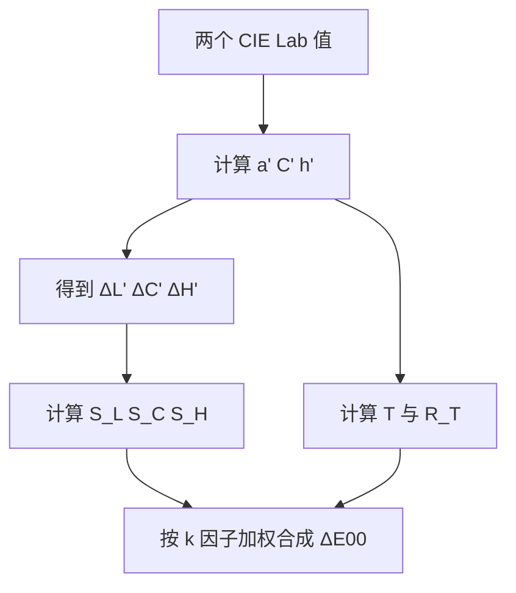

# 色差

## 这个能力解决什么

"这两个颜色差多少"看似简单，实际没有唯一答案。CIE 1976 的欧氏距离在蓝色区域会高估差异；CIE 1994 引入纺织/非纺织的权重；CIEDE2000 再加入旋转项修正蓝色区域。不同工业领域用不同公式，同一对颜色用不同公式会得到不同数值。

Colour 的做法是把这些公式全部实现，并提供统一调度入口，让使用者按标准或场景选择，而不是在代码里硬编码某一种。

## 公式家族

`delta_E` 默认使用 CIEDE2000。可选的 14 个方法注册在 `DELTA_E_METHODS`：

| 方法名 | 空间 | 特点 | 对称性 |
|--------|------|------|--------|
| `CIE 1976` | CIE Lab | 欧氏距离，最简单 | 对称 |
| `CIE 1994` | CIE Lab | 引入明度/彩度/色相权重 | 非对称 |
| `CIE 2000` | CIE Lab | 加入旋转项，工业默认 | 近似对称 |
| `CMC` | CIE Lab | 纺织业常用，`l:c` 可调 | 非对称 |
| `ITP` | ICtCp | 面向 HDR/广色域 | 对称 |
| `CAM02-LCD/SCD/UCS` | CAM02-UCS | 基于外观模型的均匀空间 | 对称 |
| `CAM16-LCD/SCD/UCS` | CAM16-UCS | CAM16 版本 | 对称 |
| `DIN99` | DIN99 | 德国标准，纺织有专门系数 | 对称 |
| `HyAB` | CIE Lab | 亮度差与色度差的混合距离 | 对称 |
| `HyCH` | CIE Lab | 亮度 city-block + 彩度/色相欧氏 | 对称 |

Huang 2015 幂函数修正（`colour.difference.power_function_Huang2015`）、同色异谱指数（`colour.difference.metamerism_index`）与 STRESS 指数不在调度表里，需要直接调用各自函数。

## CIEDE2000 的计算链

CIEDE2000 不是一条闭式公式，而是一串中间量。下图按计算顺序展开；理解这条链，才能明白 `kL/kC/kH` 三个参数到底作用在哪一步。



前半段把两组 Lab 转成 `L'`、`a'`、`C'`、`h'`，其中 `a'` 用 `G` 因子修正低彩度区域的椭圆拉伸。中段算三个差值，并把色相差折到 `[-π, π]`。后半段算三个权重函数与旋转项 `R_T`，最后按平方和开根。

`kL`、`kC`、`kH` 是"参数因子"，用于补偿不同观察条件。默认都为 1；纺织业常用 `kL=2`。它们不改变颜色本身，只改变三部分差异的相对权重。

两个细节常被忽略：

- **CIE 1994 与 CMC 是非对称的**。公式以第一个颜色为参考，交换 `a` 与 `b` 会得到不同结果。需要对称比较时用 CIEDE2000 或 UCS 距离。
- **参考条件写在文档里**。CIEDE2000 的参考条件是 D65、1000 lx、平均背景 `L*=50`、物体模式、视角大于 4°、直接接触、`ΔE<5`；超出这些条件，数值仍能算，但解释力下降。

```python
import colour

Lab_1 = [50.0, 2.6772, -79.7751]
Lab_2 = [50.0, 0.0, -82.7485]
colour.delta_E(Lab_1, Lab_2)                 # CIE 2000
colour.delta_E(Lab_1, Lab_2, method="CMC")   # 换公式
```

## 从颜色空间到色差

色差公式不直接吃 XYZ，而是吃某个均匀空间里的坐标。项目里有三类常用空间：

| 空间 | 入口 | 适用 |
|------|------|------|
| CIE Lab | `XYZ_to_Lab` | 经典色差公式的输入 |
| CAM02-UCS / CAM16-UCS | `XYZ_to_CAM02UCS`、`XYZ_to_CAM16UCS` | 需要外观模型语境时 |
| ICtCp | `XYZ_to_ICtCp` | HDR 与广色域 |

这些空间也注册在转换图里，所以可以先 `convert(xyz, "CIE XYZ", "CIE Lab")` 再算色差。CAM16-UCS 的色差实现复用了 CAM02-UCS 的代码，只是替换了系数；两个系列在数值上接近，但不应混用。

## 评估色差公式本身

有了公式，还需要判断它是否真的符合人眼。Kruskal 的 STRESS 指数（Standardized Residual Sum of Squares）就是做这件事：给一组计算色差 `d_E` 与对应的视觉色差 `d_V`，衡量两者的线性一致性。

`colour.difference.index_stress_Garcia2007` 先拟合比例因子 `F_1`，再计算归一化残差。值越接近 0，公式与视觉数据越一致。这个指标常用于比较不同色差公式在同一数据集上的表现，而不是用于单次颜色比较。

## 边界与限制

- **不同公式的数值不可直接比较**。`ΔE=2` 在 CIEDE2000 与 CMC 下不是同一件事；报告色差时必须写明公式与参数。
- **色差不是感知距离的绝对度量**。它依赖观察条件、样本大小、背景与观察者；工业容差是在特定条件下约定的。
- **JND 阈值因公式而异**。项目为 CIE 1976 提供 `colour.difference.JND_CIE1976 = 2.3`，但这不是所有公式通用的阈值。
- **同色异谱需要单独计算**。`colour.difference.metamerism_index` 处理的是两个光谱在不同光源下匹配、在另一光源下不匹配的现象，不能由 `delta_E` 代替。
- **CAM16-UCS 的测试覆盖依赖继承**。它的测试类继承自 CAM02-UCS，没有独立的数值回归测试；这是实现现状，不影响使用，但意味着该路径的独立验证强度低于 CAM02-UCS。

> 依据：`colour/difference/__init__.py:108-143`、`colour/difference/__init__.py:146-239`、`colour/difference/delta_e.py:85-150`、`colour/difference/delta_e.py:153-238`、`colour/difference/delta_e.py:275-506`、`colour/difference/delta_e.py:509-594`、`colour/difference/cam02_ucs.py:47-260`、`colour/difference/cam16_ucs.py:44-60`、`colour/difference/stress.py:48-143`、`colour/difference/metamerism_index.py:49-308`
