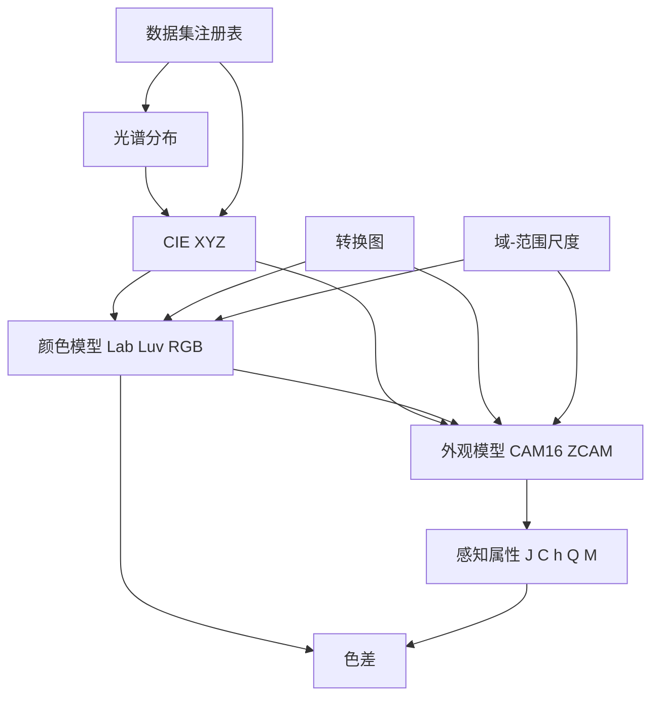

# 核心概念

这页只讲五件事。理解它们之后，其余子包的 API 都能按同一套心智模型去读。

## 概念地图

先看概念之间的关系：光谱是物理量，CIE XYZ 是连接物理与感知的桥梁，各种颜色模型是 XYZ 的不同坐标表达，外观模型再往感知属性走一步。转换图负责在这些表示之间找路，数据集则提供标准观察者、光源与色卡等参考数据。



图中值得记住的是两条方向不同的线：**数据自下而上供给**（数据集 → 光谱 → CIE XYZ → 模型），**尺度与转换图自上而下作用于模型与外观**。外观模型不是颜色模型的延长线，而是与它并列的另一条感知路径。

## 颜色表示

Colour 把每一种"颜色的写法"叫作一种颜色表示（colour representation）。它是转换图的节点名，也是 `convert` 的 `source` 与 `target` 参数取值。

常见的表示包括：

| 表示 | 例子 | 说明 |
|------|------|------|
| 光谱表示 | `Spectral Distribution` | 波长到数值的函数，描述光源、反射率或相机灵敏度；多光谱数据用 `MultiSpectralDistributions` 容器承载 |
| 三刺激值 | `CIE XYZ`、`CIE xyY`、`CIE xy` | 与人眼三色响应对应的坐标 |
| 均匀颜色空间 | `CIE Lab`、`CIE Luv`、`Oklab`、`CAM16UCS` | 让数值距离更接近感知距离 |
| 设备相关表示 | `sRGB`、`RGB`、`Scene-Referred RGB` | 带基色、白点与传递函数的 RGB 空间；BT.2020、ACES2065-1 等具体空间由 `RGB_to_RGB` 的 `colourspace` 参数指定 |
| 外观相关量 | `CAM16 JMh`、`ZCAM JMh` | 亮度 J、色彩丰富度 M、色相角 h |
| 派生量 | `CCT`、`Lightness`、`Dominant Wavelength` | 色温、明度、主波长等单一指标 |

表示名字对大小写与分隔符不敏感。转换图会把节点名统一成小写，数据集键则通过规范化映射处理大小写、空格、连字符与下划线，因此 `"CIE Lab"`、`"cie lab"`、`"cie_lab"` 通常都能命中同一个对象。

## 连续信号

光谱数据不是普通数组，而是连续函数。`SpectralDistribution` 继承自 `Signal`，内部维护两组离散值：波长（domain）与数值（range），并按需构造一个"外推器包住插值器"的函数。

这带来两个直接后果。第一，可以用任意浮点波长取值，不要求落在采样点上；第二，插值与外推策略可以逐对象替换。默认策略按数据是否等间隔选择：等间隔用 Sprague 插值，非等间隔用三次样条；外推默认用边界值常数延拓。

`MultiSpectralDistributions` 是多个 `Signal` 的容器，用来表示一组共享波长轴的光谱，例如三刺激值匹配函数、相机 RGB 三通道灵敏度或显示器三基色。

索引语义需要特别注意：用**数值**索引得到该波长处的插值结果，用**切片**索引得到按位置的样本。`sd[555.5]` 是波长 555.5 nm 的值，`sd[0:3]` 是前三个采样点。

## 域-范围尺度

这是 Colour 最容易被忽略、也最容易出错的概念。

色彩科学文献里没有统一的数值范围：CIE XYZ 与 Lab 常用 `[0, 100]`，RGB 常用 `[0, 1]`，Munsell Value 用 `[0, 10]`，色相角用 `[0, 360]`，8 位码值用 `[0, 255]`。Colour 没有强行统一 API，而是提供两种尺度：

| 尺度 | 含义 | 适用场景 |
|------|------|---------|
| `Reference` | 默认值。按文献/标准原本的范围，因此不同函数可能不一致 | 对照论文、手工推导、教学 |
| `1` | 把标量统一压到 `[0, 1]`；百分比除以 100，角度除以 360，码值除以最大码值 | 跨模型组合、机器学习、图像处理 |

函数签名里的 `Domain1`、`Domain100`、`Range360` 等类型别名不是普通类型注解，而是带元数据的 `Annotated`。这些元数据记录了参数在 `Reference` 与 `1` 两种尺度下该如何换算，`convert` 与 `get_domain_range_scale_metadata` 会读取它们。

```python
import colour

colour.get_domain_range_scale()          # 'reference'
colour.set_domain_range_scale("1")       # 全局切换
colour.get_domain_range_scale()          # '1'

with colour.domain_range_scale("reference"):
    ...                                  # 只在块内使用 Reference 尺度
```

`convert` 有一条硬约定：**路径内部固定使用 `1` 尺度**。因此它会在第一段转换前把输入缩放到 `1`，在最后一段转换后按需还原。手工调用具体函数时没有这层保护，必须自己保证输入与当前尺度一致；尺度不对不会总是报错，可能只是算出一个"看起来合理但错了"的数。

## 自动转换图

转换图是一张有向图：节点是颜色表示，边是一个转换函数。`v0.4.7` 的图有 197 条边，覆盖色度学、颜色模型、外观模型与色温等表示。

调用 `convert(a, source, target)` 时，库会做四件事：

1. 把 `source` 与 `target` 规范化为小写节点名；
2. 用 NetworkX 求最短路径；
3. 按顺序执行路径上的每个函数，每段都在 `1` 尺度下运行；
4. 把调用者传入的关键字参数按函数名分发给对应环节。

图的边是有方向的，但多数转换都有反向边；只有部分外观模型（如 Hunt、LLAB、RLAB）只注册了正向，因为原模型没有给出可靠的逆变换。

## 数据集注册表

Colour 自带大量标准数据：CIE 标准观察者、标准照明体、荧光光源、LED 光源、色卡、相机灵敏度、显示基色、Munsell 色卡等。

这些数据不是普通字典，而是 `CanonicalMapping` 或 `LazyCanonicalMapping`：

- **键规范化**：查找时依次尝试精确匹配、全小写、slug 化、去掉分隔符的规范形式，所以命名不必逐字记忆。
- **懒加载**：多数数据集的值是"工厂函数"而不是已构造对象，第一次访问时才真正生成光谱对象并缓存。这让 `import colour` 不必一次性构造上千条光谱。
- **别名**：常用数据集有短别名，例如 `MSDS_CMFS["cie_2_1931"]` 指向 CIE 1931 2° 标准观察者。

数据集的组织是分层的。以 `SDS_ILLUMINANTS` 为例，CIE 照明体与 ISO 光源先分别构造，再合并成一个映射；色度坐标 `CCS_ILLUMINANTS` 与三刺激值 `TVS_ILLUMINANTS` 则按标准观察者再分一层。

## 概念之间的组合

一次典型的颜色计算是这样组合起来的：

- 用数据集取标准观察者与光源（`MSDS_CMFS`、`SDS_ILLUMINANTS`）；
- 用光谱对象承载测量数据（`SpectralDistribution`）；
- 用 `sd_to_XYZ` 把光谱积分成三刺激值；
- 用转换图或具体模型函数进入目标空间；
- 用外观模型或色差公式得到感知层面的量。

下一页把这些组合落到包结构上，说明每一层由哪些子包承担。

> 依据：`docs/basics.rst:160-410`、`docs/basics.rst:410-520`、`colour/continuous/signal.py:238-271`、`colour/continuous/signal.py:512-565`、`colour/utilities/array.py:1008-1081`、`colour/utilities/array.py:1181-1311`、`colour/hints/__init__.py:160-171`、`colour/graph/conversion.py:1375-1690`、`colour/graph/conversion.py:1987-2040`、`colour/utilities/structures.py:322-421`、`colour/utilities/structures.py:711-774`
