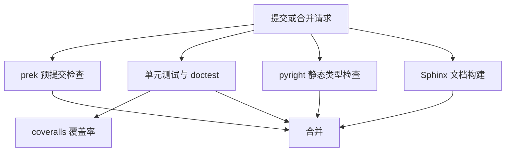

# 工程实践

## 这个页面回答什么

对选型者来说，"算法对不对"只是问题的一半；另一半是"装起来重不重、跑起来快不快、升级会不会坏、出了问题能不能定位"。这一页讲后一半。

## 依赖取舍

`v0.4.7` 的运行时依赖只有一项：`numpy>=2.0.0,<3`。其余能力全部声明为可选依赖，按任务安装。

| 可选依赖 | 启用的能力 | 缺失时的行为 |
|---------|-----------|-------------|
| `networkx` | 自动转换图 | `convert`/`conversion_path` 不可用 |
| `matplotlib` | 78 个绘图入口 | 绘图模块导入降级为占位对象 |
| `imageio` / `openimageio` | 图像读写 | 对应后端不可用 |
| `opencolorio` | OCIO 图像处理 | 函数抛安装提示（且仅 Python <3.14） |
| `scipy` | ACES IDT、部分恢复/几何算法 | 对应函数抛安装提示 |
| `pandas` | `Signal` 与 DataFrame 互转 | 转换方法不可用 |
| `pydot` / `tqdm` | 转换图的 Graphviz 输出、光谱恢复的进度条 | 返回普通对象或无进度显示 |
| `trimesh` | 网格相关几何 | 对应功能不可用 |

这种"核心极简 + extras"的策略让 `pip install colour-science` 很轻，代价是使用者必须知道自己需要哪些 extras。项目在 `utilities/requirements.py` 里为每个可选包提供 `is_*_installed` 与 `@required` 装饰器，缺失时给出可操作的错误信息，而不是底层 `ImportError`。

## 向量化

绝大多数 API 接受 n 维数组，并在最后一维上解释颜色分量。一个 `(H, W, 3)` 的图像可以直接传给 `sRGB_to_XYZ`，返回同形状的 XYZ；标量、元组、列表会被自动转成数组。

这条约定让批量计算不需要 Python 循环，也意味着**形状错误往往不会报错**：如果最后一维不是 3，函数可能把多出来的分量当成额外通道，或者广播出意外结果。传参前检查形状比事后调试便宜。

## 域-范围尺度的实现

域缩放不是一个纯函数，而是全局状态。当前尺度保存在模块级变量里，`get/set_domain_range_scale` 读写它，`domain_range_scale` 上下文管理器负责保存与恢复。

```python
import colour

with colour.domain_range_scale("1"):
    ...  # 期间所有带 Domain/Range 注解的函数都按 0-1 解释
```

这带来两个工程后果。第一，**它不是线程安全的**：多线程同时切换尺度会互相干扰。第二，**Windows 多进程不会自动继承**：`fork` 不存在，子进程拿到的是默认值；项目提供 `colour.utilities.multiprocessing_pool` 上下文管理器显式传播尺度。

## 缓存

项目内部维护一个缓存注册表 `CACHE_REGISTRY`，登记所有可清理的缓存。主要缓存包括：

| 缓存 | 作用 |
|------|------|
| 光谱重塑结果 | 避免重复对齐同一条光谱 |
| 三刺激值积分 | 相同光谱与观察者只算一次 |
| ASTM E308 权重表 | 权重表构造较贵，按参数复用 |
| 域缩放元数据 | 避免重复解析函数注解 |
| 色温 Planckian 表 | Ohno 2013 的查表基础 |
| Munsell 与色域边界数据 | 重复查询的中间结果 |

可以通过环境变量 `COLOUR_SCIENCE__DISABLE_CACHING` 全局关闭缓存，或在代码里用 `colour.utilities.caching_enable` 上下文管理器局部关闭。调试"结果为什么和上次不同"时，先关缓存往往能排除状态污染。

## 类型系统

类型注解不只是给 IDE 看的。`Domain1`、`Domain100`、`Range360` 这些别名是 `Annotated[ArrayLike, 100]` 形式，携带缩放元数据。`convert` 正是靠这些元数据在首尾自动换算尺度。

这也解释了为什么"手写调用具体函数"和"用 convert"在尺度行为上不同：前者不读元数据，后者读。新增函数时如果漏写 `Domain*`/`Range*` 注解，`convert` 就无法正确缩放，路径会悄悄按 `1` 尺度处理。

## 测试与质量门禁

项目用 unittest 风格组织测试，而不是 pytest 参数化。规模如下：

| 指标 | 数量 |
|------|------|
| 测试文件 | 222 |
| 测试方法 | 约 2500 |
| 测试类 | 913 |
| doctest 行 | 4165，分布在上百个模块 |
| CI 工作流 | 3 条：质量与单元测试、静态类型检查、文档构建 |

三条工作流都放在仓库的 .github/workflows/ 目录下。CI 的测试矩阵覆盖 macOS、Ubuntu、Windows 与 Python 3.11–3.14。测试命令同时启用 `--doctest-modules`，意味着文档里的示例也会被执行；示例写错会让 CI 失败。这是项目保证"文档与实现同步"的主要手段。



静态类型检查只在一个平台与一个 Python 版本上跑，是"抽查"而不是全矩阵；单元测试才是全矩阵。文档构建会把图表产物上传，供 ReadTheDocs 使用。

## 发布流程

构建用 hatchling，发布用 `tasks.py` 里的 invoke 任务编排：清理、代码质量、预提交、测试、示例、文档、依赖导出、打包、上传。版本号集中在 `colour/__init__.py` 的三个变量里，发布任务会校验版本一致性。

`CHANGES.rst` 不含逐版本变更，变更记录以 GitHub Releases 为准；`docs/index.rst` 另有一个指向开发分支草稿发布说明的链接。对使用者来说，升级前应看 Releases 而不是仓库内的 CHANGES。

## 已知的工程限制

- **没有 Array API 标准兼容**。`v0.4.7` 的所有数组操作都绑定 NumPy，传入 JAX/PyTorch 数组会被 `np.asarray` 物化，无法保留设备或梯度。
- **没有自动微分**。项目没有为反向传播设计计算图；需要梯度的场景应使用支持 AD 的框架，或自行对解析式求导。
- **域缩放是全局状态**。多线程与多进程需要额外处理；这不是 bug，而是这套 API 的固有代价。
- **类型检查不覆盖全矩阵**。pyright 只在 macOS + Python 3.13 上跑，其他平台的类型问题可能漏检。
- **部分测试存在覆盖缺口**。外观模型的 LLAB 与 RLAB 测试文件与 Kim2009、Nayatani95 重复，CAM16-UCS 的测试继承自 CAM02-UCS；这些是当前实现的测试现状。

> 依据：`pyproject.toml:1-73`、`pyproject.toml:85-149`、`pyproject.toml:151-207`、`docs/advanced.rst:7-83`、`colour/utilities/common.py:91-383`、`colour/utilities/array.py:1008-1081`、`colour/utilities/requirements.py:93-203`、`colour/utilities/requirements.py:536-580`、`colour/hints/__init__.py:160-171`、`tasks.py:176-380`
