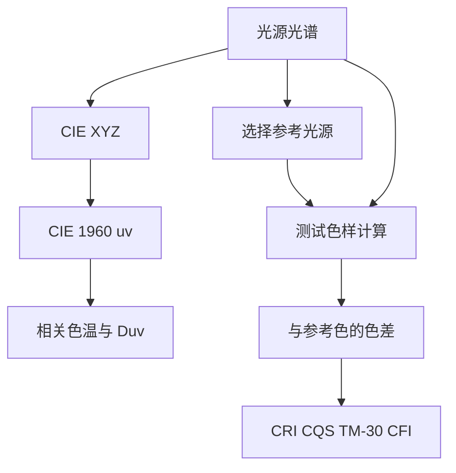

# 光源品质与色温

## 这个能力解决什么

评估一个光源通常要回答两个问题：它偏暖还是偏冷（色温），以及它还原颜色的能力如何（显色品质）。前者是一个连续量，后者是一组指标；两者都从光谱或色度坐标出发，但计算路径不同。

## 色温与相关色温

色温描述黑体辐射的颜色。实际光源的色度往往不落在黑体轨迹上，这时用**相关色温**（Correlated Colour Temperature，CCT）表示"最接近的黑体温度"，并用 **Duv** 表示偏离轨迹的距离与方向。

Colour 提供四个 `uv_to_CCT` 方法：

| 方法 | 原理 | 特点 |
|------|------|------|
| `Ohno 2013` | 在 Planckian 表上做三角/抛物线插值，同时给出 Duv | 默认方法，兼顾精度与速度 |
| `Robertson 1968` | 等温线交点 | 经典方法，速度快 |
| `Planck 1900` | 直接求黑体色度 | 理论基准 |
| `Krystek 1985` | 有理函数近似 | 解析式，适合实时 |

`uv_to_CCT` 返回 `(T_cp, Δ_uv)` 二元组；`CCT_to_uv` 做反向。如果只有 CIE xy 坐标，可以用 `xy_to_CCT` 与 `CCT_to_xy`，它们默认走 CIE D 系列日光轨迹，适合近似日光的光源，不适合任意光源。

CCT 的适用范围是有限制的：Ohno 2013 的实现把范围限定在 1000 K 到 100000 K；超出范围的外推没有物理意义。对彩色光源（如纯红 LED），CCT 也不是有意义的描述。

## 显色与色彩品质

显色指标回答"在这个光源下，物体的颜色与参考光源下差多少"。不同指标用不同的测试色样、不同的参考光源与不同的聚合方式。

| 指标 | 入口 | 测试色样 | 输出 | 方法版本 |
|------|------|---------|------|---------|
| CRI | `colour_rendering_index` | 8 个标准色样（另有 14 个特殊色样） | `R_a` 与各 `R_i` | CIE 1995、CIE 2024 |
| CQS | `colour_quality_scale` | 15 个视觉样品 | `Q_a` 等 | NIST CQS 7.4、9.0 |
| TM-30 | `colour.quality.colour_fidelity_index_ANSIIESTM3018` | 99 个色样 | `R_f`、`R_g`、16 个色相区间的 `R_s` | ANSI/IES TM-30-18 |
| CIE 2017 CFI | `colour.quality.colour_fidelity_index_CIE2017` | 99 个色样 | 保真度指数 | CIE 2017 |
| SSI | `spectral_similarity_index` | 光谱相似度 | 0–100 的相似度 | Academy SSI |

`colour_fidelity_index` 是 TM-30 与 CIE 2017 CFI 的统一入口，通过 `COLOUR_FIDELITY_INDEX_METHODS` 选择。CRI 与 CQS 有各自的调度函数，因为输入输出结构差异较大。

这些指标的数值不可互换。CRI 的 90 与 TM-30 的 `R_f=90` 不是同一件事：前者基于少量色样的平均值，后者基于 99 个色样的保真度并附带色域指标。选择指标时应看行业惯例与监管要求，而不是只看数值高低。

## 计算路径

下图把两条路径放在一起：色温走色度坐标，显色指标走光谱与测试色样的比较。



两条路径的共同起点是光谱；差别在于色温只需要色度坐标，显色指标需要完整光谱，因为它要逐波长地比较测试色样在待测光源与参考光源下的反射结果。

## 使用示例

```python
import colour

sd = colour.SDS_ILLUMINANTS["FL2"]
XYZ = colour.sd_to_XYZ(sd, illuminant=sd)
XYZ = 100 * XYZ / XYZ[1]              # 光源按自发光体处理，Y 归一化到 100
uv = colour.XYZ_to_CIE1960UCS(XYZ)[:2]
CCT, duv = colour.uv_to_CCT(uv, method="Ohno 2013")
ra = colour.colour_rendering_index(sd)
print(CCT, duv, ra)
```

## 边界与限制

- **CCT 只对接近白光的刺激有意义**。彩色光源、窄带光源的相关色温可能落在轨迹外很远，Duv 会很大，此时 CCT 不是有用的描述。
- **显色指标依赖参考光源的选择**。同一光源用不同参考光源会得到不同数值；TM-30 与 CIE 2017 都规定了参考光源的选取规则，跨指标比较时必须确认规则一致。
- **SSI 衡量的是光谱相似度，不是视觉显色**。两个光谱相似度高，不代表视觉上一定匹配；它用于内容交换与存档，不用于照明品质评级。
- **绘图只是展示**。`plot_single_sd_colour_rendering_index_bars` 等函数把指标画成柱状图，不改变计算逻辑。

> 依据：`colour/temperature/__init__.py:110-467`、`colour/temperature/ohno2013.py:66-457`、`colour/temperature/robertson1968.py:119-360`、`colour/temperature/planck1900.py:52-177`、`colour/temperature/krystek1985.py:47-172`、`colour/temperature/cie_d.py:50-185`、`colour/quality/__init__.py:56-123`、`colour/quality/cri.py:149-399`、`colour/quality/cqs.py:197-609`、`colour/quality/tm3018.py:40-234`、`colour/quality/cfi2017.py:184-459`、`colour/quality/ssi.py:51-203`、`colour/plotting/quality.py:78-500`
