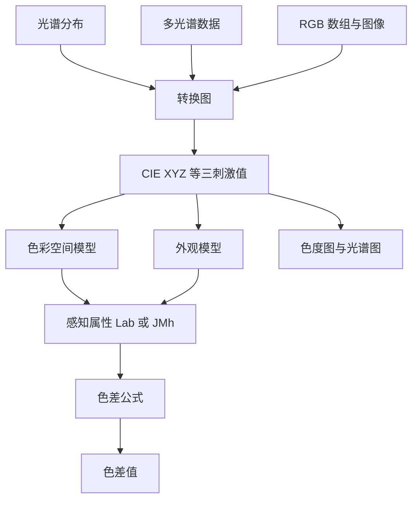

# 项目概览

## 一句话定位

Colour 是一个把色彩科学算法与标准数据集做成 Python API 的库。它不负责渲染，也不做色彩管理流程编排；它负责把"颜色怎么算"这件事算对。

## 解决什么问题

色彩科学的困难不在公式本身，而在三件事：

**算法散落在论文与标准里。** 同一个"色差"有 CIE 1976、CIE 1994、CIEDE2000、CMC 等十余种公式，各自有适用条件与参数；外观模型有 CAM16、CIECAM02、ZCAM 等十余种实现。研究者与工程师要不重复推导、不重复实现，就需要一个经过交叉验证的公共实现。

**数据格式与尺度不统一。** 光谱仪输出浮点波长，CIE 标准按 1 nm 或 5 nm 制表；色度坐标可能是 `xy`、`uv` 或 `u'v'`；同一个 CIE XYZ 在论文里常用 `[0, 100]`，在 RGB 流程里常用 `[0, 1]`。项目在 `v0.3.12` 引入域-范围尺度（domain-range scale），用一套显式约定处理这种不一致，而不是让每个函数各写一套归一化。

**转换路径要手工串。** 从光谱分布到 sRGB 需要先积分成 CIE XYZ，再做色适应，再乘 RGB 矩阵、套传递函数。Colour 把这些步骤做成一张有向图，调用者只需要说明起点与终点。

## 给谁用

| 使用者 | 典型场景 | 项目提供什么 |
|--------|---------|--------------|
| 色彩科学研究者和学生 | 复现论文中的外观模型、色差公式、色适应实验 | 与文献对应的函数、参考数据与逐条公式的文档 |
| 图形/影视工程师 | 摄影机色彩空间、ACES 流程、LUT 与图像转换 | RGB 色彩空间数据集、CCTF、ACES IDT、LUT/OCIO 读写 |
| 显示器与照明工程师 | 色温、显色指数、光源品质、显示基色 | CCT/Duv、CRI/CQS/TM-30、显示与光源数据集 |
| 计算机视觉与成像研究者 | 光谱恢复、色觉缺陷模拟、对比敏感度 | 光谱上采样、CVD 矩阵、Barten 模型 |
| 数据可视化与设计工具开发者 | 颜色空间转换、色差、色域判断 | 向量化 API、转换图、色域体积与包含判断 |

## 核心能力一览

| 能力组 | 内容 | 关键入口 |
|--------|------|---------|
| 自动转换 | 在颜色表示之间找最短路径并执行 | `colour.convert`、`colour.graph.conversion_path` |
| 色彩空间与模型 | CIE XYZ/Lab/Luv/xyY、RGB 及各类感知均匀空间 | `colour.models`、`colour.RGB_COLOURSPACES` |
| 光谱与色度学 | 光谱分布、多光谱数据、CMFS、光源、三刺激值积分 | `colour.SpectralDistribution`、`colour.sd_to_XYZ` |
| 色适应 | Von Kries、Bradford、CAT02、CAT16、CMCCAT2000 等 | `colour.chromatic_adaptation` |
| 外观模型 | CAM16、CIECAM02、CIECAM16、Hellwig2022、ZCAM 等 | `colour.XYZ_to_CAM16` 等 |
| 色差 | CIEDE2000、CMC、CAM02/CAM16-UCS、DIN99、HyAB 等 | `colour.delta_E` |
| 特性化与 IO | 色彩校正矩阵、ACES IDT、图像/LUT/OCIO/光谱文件 | `colour.colour_correction`、`colour.read_image` |
| 光源品质与色温 | CCT/Duv、CRI、CQS、TM-30、CIE 2017 CFI、SSI | `colour.uv_to_CCT`、`colour.colour_fidelity_index` |
| 专门分析 | 色域体积、光谱恢复、薄膜干涉、CVD、对比敏感度 | `colour.volume`、`colour.recovery`、`colour.phenomena` |
| 可视化 | 色度图、光谱图、色域截面、转换图 | `colour.plotting` 的 66 个 `plot_*` 函数 |

这张图把上述能力串成一条数据流：左侧是输入形态，中间是核心计算，右侧是使用者真正拿到的结果。读的时候注意光谱与三刺激值之间的双向箭头——Colour 既能从光谱算颜色，也能从颜色反推光谱。



## 技术栈

| 组件 | 用途 | 选型与代价 |
|------|------|-----------|
| Python ≥3.11 | 运行环境 | `v0.4.7` 支持 3.11–3.14，放弃更早版本以使用现代类型注解 |
| NumPy ≥2.0 | 唯一运行时依赖 | 所有计算围绕 `ndarray` 与广播设计；换来极轻的安装体积，代价是没有 GPU/自动微分后端 |
| NetworkX（可选） | 构建自动转换图 | 只有调用 `convert`/`conversion_path` 时需要；图算法交给成熟库 |
| Matplotlib（可选） | 绘图 | 66 个可直接调用的 `plot_*` 入口；未安装时导入会降级为占位对象而不是直接崩溃 |
| SciPy（可选） | 优化、插值、信号处理 | ACES IDT 拟合、部分光谱恢复方法依赖它 |
| OpenImageIO / imageio（可选） | 图像与光谱图像读写 | 支持 EXR 等高位深格式；OpenImageIO 是默认后端 |
| OpenColorIO（可选） | OCIO 配置驱动的图像处理 | 只在 Python <3.14 可用，属于集成而非核心 |
| Sphinx + pydata 主题 | 文档 | API 参考由 docstring 自动生成，示例同时作为 doctest 执行 |

## 最小可用示例

下面这段代码展示了项目最常用的入口：给一个光谱分布，直接要 sRGB。`convert` 会自动选择路径，并在需要时把参数转发给路径上的具体函数。

```python
import colour

sd = colour.SDS_COLOURCHECKERS["ColorChecker N Ohta"]["dark skin"]
RGB = colour.convert(sd, "Spectral Distribution", "sRGB")
print(RGB)
```

如果不指定光源，路径中的 `sd_to_XYZ` 使用 CIE 标准照明体 E；要改用 D65 或 FL2，把参数按函数名传进去即可：

```python
colour.convert(sd, "Spectral Distribution", "sRGB",
               sd_to_XYZ={"illuminant": colour.SDS_ILLUMINANTS["FL2"]})
```

## 与其他方案的分工

Colour 不替代 OpenColorIO 或显示校准软件。OCIO 负责"按配置文件把像素从 A 变换到 B"，Colour 负责"这个变换背后的色彩科学量怎么算"；两者在 `colour.io.process_image_OpenColorIO` 处交接。需要完整色彩管理策略、显示校准或渲染管线时，Colour 通常作为计算内核被调用，而不是流程主角。

> 依据：`README.rst:304-418`、`README.rst:2287-2300`、`pyproject.toml:1-73`、`colour/__init__.py:15-60`、`docs/basics.rst:410-520`
