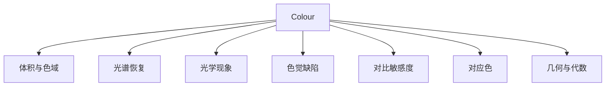

# 专门领域能力

## 这些模块是什么

前几页讲的是主链路：光谱 → XYZ → 颜色模型/外观 → 色差。Colour 还包含一批相对独立的小模块，它们不常出现在同一条流水线里，但各自解决一个具体问题。这一页给它们一张地图，避免读者在二十多个子包里逐个试。



这张图刻意不画依赖关系：这些模块共享底层的数组、代数与光谱对象，但彼此之间没有固定顺序。读法是先找问题、再找模块，而不是沿着一条链路往下走。

## 能力表

表里的入口大多在 `colour` 顶层命名空间；带 `子包.` 前缀的只从对应子包导出，需要写成 `colour.phenomena.thin_film_tmm` 这样的全名。

| 模块 | 解决什么 | 关键入口 | 主要依赖 |
|------|---------|---------|---------|
| `volume` | 判断颜色是否落在某个色域内，估计色域体积 | `is_within_macadam_limits`、`is_within_pointer_gamut`、`is_within_visible_spectrum`、`RGB_colourspace_volume_MonteCarlo` | NumPy、SciPy（部分） |
| `recovery` | 从三刺激值或 RGB 反推光谱分布 | `XYZ_to_sd`、`recovery.RGB_to_sd_Mallett2019` | NumPy、SciPy（部分） |
| `phenomena` | 薄膜干涉、多层膜、瑞利散射、材料折射率 | `phenomena.thin_film_tmm`、`phenomena.multilayer_tmm`、`sd_rayleigh_scattering` | NumPy |
| `blindness` | 模拟色觉缺陷（CVD）下的颜色外观 | `matrix_cvd_Machado2009`、`msds_cmfs_anomalous_trichromacy_Machado2009` | NumPy |
| `contrast` | 人眼对比敏感度函数 | `contrast.contrast_sensitivity_function_Barten1999` | NumPy |
| `corresponding` | 不同适应条件下的对应色预测 | `corresponding_chromaticities_prediction` | NumPy |
| `notation` | Munsell 记法、CSS 颜色关键字、十六进制互转 | `munsell_colour_to_xyY`、`xyY_to_munsell_colour`、`notation.RGB_to_HEX` | NumPy |
| `geometry` | 椭圆拟合、线段相交、凸包截面与几何图元 | `geometry.ellipse_fitting`、`geometry.intersect_line_segments`、`geometry.primitive_grid` | NumPy、SciPy（部分） |
| `algebra` | 插值、外推、矩阵运算、回归 | `SpragueInterpolator`、`KernelInterpolator`、`algebra.vecmul`、`algebra.sdiv` | NumPy |
| `biochemistry` | Michaelis–Menten 酶动力学 | `biochemistry.reaction_rate_MichaelisMenten`、`biochemistry.substrate_concentration_MichaelisMenten` | NumPy |

## 几个值得单独说明的模块

**体积与色域**回答的是"能不能表示"，与转换页的路径问题互补。MacAdam 极限基于人眼分辨阈值的椭圆；Pointer 色域基于真实表面色；可见光谱体基于光谱轨迹。三者不是同一个集合，判断"颜色是否可见"时要明确用哪一个。

**光学现象**是项目里最偏物理的部分。`thin_film_tmm` 与 `multilayer_tmm` 用传输矩阵法计算薄膜反射/透射光谱，`sd_rayleigh_scattering` 计算瑞利散射的光谱分布。它们输出的是光谱，可以继续接回 `SpectralDistribution` 与色度学主链路。

**色觉缺陷**用 Machado 2009 的矩阵模型模拟不同类型的 CVD。它变换的是 RGB 或 LMS 响应，不是光谱；适合可视化与可访问性检查，不适合临床诊断。

**对应色**与色适应相关但不同：色适应是"给定变换求对应色"，对应色预测是"给定实验数据比较不同模型的预测能力"。`corresponding` 子包内置 Breneman 实验数据与五种预测模型，主要用于模型评估。

**颜色记法**是另一类"表示"问题。Munsell 用色相/明度/彩度三元组描述颜色，与 CIE xyY 的互转需要查 renotation 数据并做迭代反解；`MUNSELL_VALUE_METHODS` 提供七种明度函数（Priest 1920、Munsell 1933、Moon 1943、Saunderson 1944、Ladd 1955、McCamy 1987、ASTM D1535）。CSS Color 3 关键字与十六进制是较简单的文本表示，用于 Web 与设计工具。

**几何与代数**是支撑模块。椭圆拟合用于 MacAdam 椭圆与色域边界；凸包截面用于色域可视化；Sprague 与核插值用于光谱重采样。它们本身不含颜色语义，但被上层大量复用。

## 使用示例

以 CVD 模拟为例：先取一个 Machado 2009 矩阵，再作用到 RGB 向量上。矩阵是经验拟合结果，作用于模型约定的三通道响应，不代表真实视网膜生理过程。

```python
import colour

M = colour.matrix_cvd_Machado2009("Deuteranomaly", 1.0)
simulated = colour.algebra.vecmul(M, [0.5, 0.2, 0.1])
```

## 边界与限制

- **这些模块不共享同一条流水线**。它们各自定义输入输出，组合方式需要使用者自己决定。
- **部分功能依赖 SciPy 或 trimesh**。体积、几何、光谱恢复的某些路径需要可选依赖；缺失时对应函数抛错而不是静默降级。
- **建模范围有限**。薄膜模型假设平面、均匀、各向同性层；瑞利散射假设小粒子；CVD 矩阵是经验模型。超出假设的场景需要更专门的工具。
- **生化模块与颜色无关**。它实现 Michaelis–Menten 动力学，出现在这个库里是因为项目维护者把相关研究一并收纳；不要把它当成颜色计算的一部分。

> 依据：`colour/volume/macadam_limits.py:87-140`、`colour/volume/pointer_gamut.py:37-79`、`colour/volume/spectrum.py:393-463`、`colour/volume/rgb.py:202-436`、`colour/phenomena/interference.py:151-448`、`colour/phenomena/rayleigh.py:535-867`、`colour/blindness/machado2009.py:153-389`、`colour/contrast/barten1999.py:60-522`、`colour/corresponding/prediction.py:690-798`、`colour/geometry/ellipse.py:222-350`、`colour/geometry/primitives.py:85-632`、`colour/algebra/interpolation.py:449-482`、`colour/biochemistry/michaelis_menten.py:161-407`
