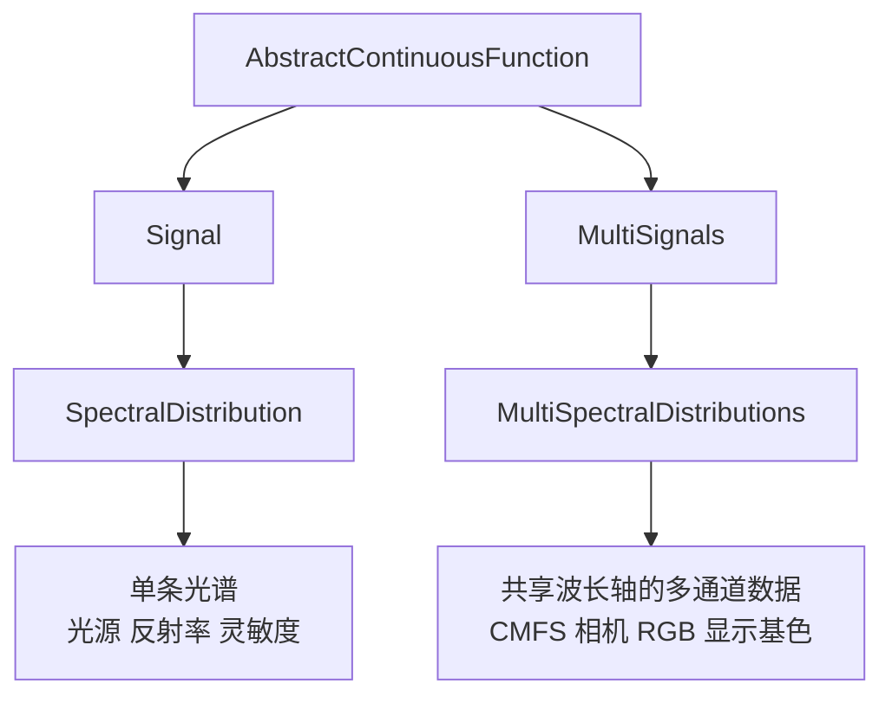
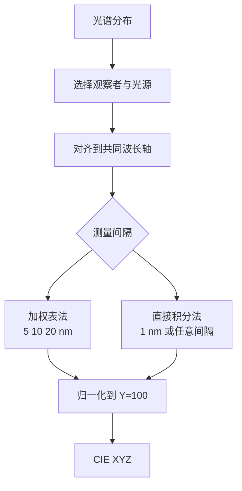

# 光谱数据

## 这个能力解决什么

光谱数据看起来只是"波长 → 数值"的两列数字，实际使用时有四个麻烦：波长是浮点且间隔不规则、不同仪器的测量带宽不同、标准数据按固定间隔制表、比较两组数据前必须对齐到同一波长轴。

Colour 用"连续函数"而不是数组来承载光谱，把插值、外推、对齐、裁剪都收进对象方法，避免每个分析脚本重复写这些步骤。

## 连续信号模型

`Signal` 把离散的 domain（自变量）与 range（因变量）包装成一个可调用函数。函数由两部分组成：内层的插值器与外层的外推器。



这个层次的关键在于：`Signal` 与 `MultiSignals` 是兄弟关系，不是父子；`MultiSignals` 不是"多个 Signal 的数组"，而是一个容器，内部为每个通道保存一个 `Signal`。因此多光谱数据可以逐通道设置插值器，也可以整体批量设置。

### 插值与外推的默认策略

| 对象 | 默认插值 | 默认外推 | 说明 |
|------|---------|---------|------|
| 裸 `Signal` | Lanczos 核插值，窗口 3 | 常数，左右为 NaN | 通用连续函数，不假设光谱语义 |
| `SpectralDistribution` | 等间隔用 Sprague，非等间隔用三次样条 | 边界值常数延拓 | 遵循 CIE 15:2004 的推荐 |
| `MultiSpectralDistributions` | 逐通道继承 `SpectralDistribution` 的默认 | 同上 | 构造时按第一条通道的间隔判断是否均匀 |

Sprague 插值需要等间隔且至少 6 个点；数据不满足时选三次样条。这个选择不是"更精确"的问题，而是"在光谱数据上不外推出振荡"的问题。

### 对齐、裁剪与重采样

| 方法 | 行为 | 何时用 |
|------|------|--------|
| `interpolate(shape)` | 在现有边界内重采样到目标间隔，不扩展 | 统一采样率 |
| `extrapolate(shape)` | 向两侧补点，默认常数延拓 | 目标范围超出测量范围 |
| `align(shape)` | 先插值再外推 | 两条光谱要对齐比较 |
| `trim(shape)` | 裁到目标边界，不生成新点 | 只保留共同区间 |
| `colour.colorimetry.reshape_sd(sd, shape)` | 以上方法的统一入口，带缓存 | 一次性整理 |

默认目标形状是 `SpectralShape(360, 780, 1)`，即 ASTM E308 使用的 360–780 nm、1 nm 间隔。这个默认值出现在 `SPECTRAL_SHAPE_DEFAULT` 与 `SPECTRAL_SHAPE_ASTME308` 两处，后者是前者的别名。

## 内置数据集

数据集按用途分组，全部通过 `CanonicalMapping` 或 `LazyCanonicalMapping` 暴露。下表列出主要注册表与规模。

| 注册表 | 内容 | 条目规模 |
|--------|------|---------|
| `MSDS_CMFS` | 标准观察者、LMS 锥体基函数、RGB 匹配函数 | 10 个数据集，含别名共 12 个键 |
| `SDS_ILLUMINANTS` | CIE 标准照明体与 ISO 光源 | 59 个键 |
| `SDS_LIGHT_SOURCES` | RIT、NIST 的传统光源、LED、Philips 光源 | 56 个键 |
| `SDS_LEFS` | 明视觉与暗视觉光效函数 | 7 个数据集，含别名共 10 个键 |
| `SDS_COLOURCHECKERS` | 色卡光谱（BabelColor、Ohta、PMC） | 3 组 |
| `MSDS_CAMERA_SENSITIVITIES` | 相机光谱灵敏度 | DSLR 数据集 |
| `MSDS_DISPLAY_PRIMARIES` | CRT 与 LCD 显示基色 | 两组 |

这些数字来自数据集模块的键统计；实际对象在首次访问时才构造，因此 `import colour` 不会因为数据集多而变慢。

数据集的键有规范化与别名。例如标准观察者既可以用完整名 `"CIE 1931 2 Degree Standard Observer"`，也可以用 `"cie_2_1931"`；色卡 `"ColorChecker N Ohta"` 也可以用 `"cc_ohta"` 或 `"ISO 17321-1"`。

## 从光谱到 CIE XYZ

这是整个库最核心的一次积分。Colour 提供两条路径，默认走 ASTM E308 加权表法。



### 两条路径的差别

**直接积分法**在每个波长上算 `反射率 × 光源 × 匹配函数 × 波长间隔`，再求和。它直观、适用于任意采样，但要求光谱与匹配函数在同一波长轴上，且采样足够密。

**ASTM E308 加权表法**先把 1 nm 的匹配函数与光源折算成"每个测量波长的权重"，之后只需对测量值做加权求和。它专为 5 nm、10 nm、20 nm 的工业测量设计，能用 Lagrange 系数补偿较粗的采样，并在光谱被截短时把缺失权重补到首尾波长。

| 方法 | 键名 | 适用间隔 | 特点 |
|------|------|---------|------|
| ASTM E308 | `"ASTM E308"` | 1/5/10/20 nm | 默认；带截短补偿与 5/20 nm 特殊处理 |
| 直接积分 | `"Integration"` | 任意 | 精度依赖采样密度；多光谱输入强制走这条 |

`sd_to_XYZ` 的默认方法是 `"ASTM E308"`，默认光源是 CIE 标准照明体 E，默认观察者是 CIE 1931 2°。注意这与 `colour.colorimetry.handle_spectral_arguments` 的默认光源 D65 不同：前者是"没有指定光源时"的兜底，后者是辅助函数的默认参数。

```python
import colour

sd = colour.SpectralDistribution({500: 0.06, 520: 0.07, 540: 0.08,
                                  560: 0.09, 580: 0.11, 600: 0.13})
XYZ = colour.sd_to_XYZ(sd, illuminant=colour.SDS_ILLUMINANTS["D65"])
```

## 从 XYZ 反推光谱

`colour.recovery` 解决相反的问题：只给三刺激值，恢复一条可能的光谱。这是欠定问题，不同方法给出不同的先验假设。

| 方法 | 先验/策略 | 入口 |
|------|----------|------|
| Otsu 2018 | 用训练集与平滑约束优化 | `colour.recovery.XYZ_to_sd_Otsu2018` |
| Jakob 2019 | 基于光谱基与非线性优化 | `colour.recovery.XYZ_to_sd_Jakob2019` |
| Mallett 2019 | 面向 RGB 输入的基函数方法 | `colour.recovery.RGB_to_sd_Mallett2019` |
| Meng 2015 | 主成分分析 | `colour.recovery.XYZ_to_sd_Meng2015` |
| Smits 1999 | 分段基函数，速度快，从 RGB 恢复 | `colour.recovery.RGB_to_sd_Smits1999` |

统一入口是 `colour.XYZ_to_sd`，通过 `XYZ_TO_SD_METHODS` 选择方法。恢复结果不是唯一解，适合渲染、纹理与可视化，不适合需要物理可解释性的光谱测量。

## 边界与限制

- **外推不是测量**。默认常数延拓只为让函数在边界外有定义；把外推区当真实数据会得到错误积分。
- **波长范围要覆盖匹配函数**。低于 360 nm 或高于 780 nm 的贡献通常很小，但截断位置会影响高精度比较。
- **不处理荧光与偏振**。光谱模型是"入射波长等于出射波长"的线性模型；荧光增白剂、偏振相关反射需要外部模型。
- **多光谱到 XYZ 强制用积分法**。`sd_to_XYZ` 接受 `MultiSpectralDistributions` 时会警告并切到 `colour.colorimetry.sd_to_XYZ_integration`，因为加权表法只定义在单条光谱上。

> 依据：`colour/continuous/abstract.py:55-121`、`colour/continuous/signal.py:238-271`、`colour/continuous/signal.py:512-565`、`colour/continuous/multi_signals.py:305-420`、`colour/colorimetry/spectrum.py:113-312`、`colour/colorimetry/spectrum.py:562-575`、`colour/colorimetry/spectrum.py:1205-1505`、`colour/colorimetry/spectrum.py:2708-2828`、`colour/colorimetry/tristimulus_values.py:130-207`、`colour/colorimetry/tristimulus_values.py:287-544`、`colour/colorimetry/tristimulus_values.py:892-1093`、`colour/colorimetry/tristimulus_values.py:1101-1306`、`colour/colorimetry/datasets/cmfs.py:1096-1343`、`colour/colorimetry/datasets/illuminants/sds.py:4582-4916`、`colour/recovery/__init__.py:89-520`
