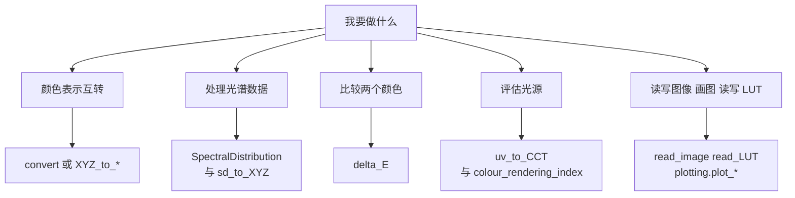

# 上手与配方

## 安装

核心安装只需要 NumPy。按任务追加 extras：绘图、图像、转换图、优化各自独立。

```bash
pip install colour-science                 # 核心
pip install "colour-science[optional]"     # 图像 绘图 转换图 优化等
conda install -c conda-forge colour-science
```

如果不是用 pip 的 extras，也可以单独安装需要的包，例如只装 `matplotlib` 用于绘图、只装 `networkx` 用于 `convert`。

## 先选入口

下面的决策图按"你想做什么"分流。多数任务不需要读完整 API，只要找到对应入口。



## 常见任务对照

| 任务 | 推荐入口 | 关键参数 |
|------|---------|---------|
| 光谱转 sRGB | `convert(sd, "Spectral Distribution", "sRGB")` | 光源通过 `sd_to_XYZ={"illuminant": ...}` 传入 |
| XYZ 转 Lab | `XYZ_to_Lab(XYZ, illuminant)` | 白点必须与 XYZ 对应 |
| 两个 RGB 空间互转 | `RGB_to_RGB(RGB, in, out)` | 是否需要 CCTF 解码/编码 |
| 换光源 | `chromatic_adaptation(XYZ, XYZ_w, XYZ_wr)` | 方法默认 Von Kries |
| 色差 | `delta_E(Lab_1, Lab_2, method="CIE 2000")` | 纺织用 `kL=2` |
| 外观属性 | `XYZ_to_CAM16(XYZ, XYZ_w, L_A, Y_b, surround)` | 观看条件比公式更易错 |
| 色温 | `uv_to_CCT(uv)` | 默认 Ohno 2013 |
| 显色指数 | `colour_rendering_index(sd)` | 默认 CIE 1995 |
| 读图像 | `read_image(path)` | 默认 OpenImageIO |
| 读 LUT | `read_LUT(path)` | 按扩展名推断格式 |
| 画色度图 | `plot_chromaticity_diagram_CIE1931()` | 需要 matplotlib |

## 域缩放：最容易错的地方

默认尺度是 `Reference`，也就是"按文献原本的范围"。这意味着 `XYZ_to_Lab` 期望 `[0, 100]` 的 XYZ，而 `XYZ_to_sRGB` 期望 `[0, 1]` 的 XYZ。同一个 XYZ 数组不能同时喂给两者。

两种正确做法：

- **显式换算**：进入 `[0, 1]` 的模型前除以 100，出来再乘回去。
- **切换尺度**：用 `colour.set_domain_range_scale("1")` 或上下文管理器，让带注解的函数自动换算。

`convert` 已经替你做了第二件事：它在路径内部固定使用 `1`，所以 `convert` 的输入输出都应按 `1` 解释；如果手上是 `[0, 100]`，打开 `from_reference_scale=True`。

## 绘图

`colour.plotting` 提供 66 个可直接调用的 `plot_*` 入口，覆盖色度图、光谱、色域、色温轨迹、CVD 模拟与转换图。它们共享一套样式与渲染机制：

- 调用 `colour_style()` 设置统一风格；
- 用 `override_style()` 临时覆盖；
- `render()` 负责 `show`、布局与保存。

绘图是可选依赖。没有安装 matplotlib 时，导入不会崩溃，而是把 matplotlib 相关对象替换为占位对象；真正调用绘图函数时才需要安装。

```python
from colour.plotting import colour_style, plot_chromaticity_diagram_CIE1931

colour_style()
plot_chromaticity_diagram_CIE1931(standalone=True)
```

## 调试与警告

项目用自定义警告类别区分问题来源：`ColourWarning`、`ColourUsageWarning`、`ColourRuntimeWarning`。环境变量可以过滤或增强这些警告，例如让警告附带完整 traceback，或把运行时警告静音。

域缩放不对时，函数通常不会抛错，而是给出"值超出预期范围"的警告并继续算。看到 `ColourWarning` 时不要忽略，它往往意味着输入尺度或观看条件不匹配。

## 几个常见坑

- **RGB 默认是线性的**。`RGB_to_RGB` 默认不解码/编码 CCTF；直接把 sRGB 图像喂进去会得到偏亮或偏暗的结果。
- **`convert` 的默认光源是 E**。这与很多示例里的 D65 不同；需要 D65 时显式传 `sd_to_XYZ={"illuminant": SDS_ILLUMINANTS["D65"]}`。
- **光谱用数值索引取值，用切片取样本**。`sd[500]` 是波长 500 nm 的值，不是第 500 个样本。
- **多光谱转 XYZ 会强制走积分法**。传 `MultiSpectralDistributions` 时加权表法不可用，函数会警告并切换。
- **外观模型的 `L_A` 是绝对亮度**。单位是 cd/m²，不是相对值；把 `Y_b` 当成 `L_A` 是最常见的参数错误。
- **路径可能不是你预期的那条**。用 `describe_conversion_path` 确认，或在关键任务里直接调用具体函数。

> 依据：`README.rst:2287-2333`、`docs/basics.rst:410-520`、`docs/basics.rst:520-696`、`docs/advanced.rst:7-83`、`colour/graph/conversion.py:1987-2040`、`colour/graph/conversion.py:1860-1960`、`colour/plotting/__init__.py:1-35`、`colour/plotting/common.py:244-468`、`colour/utilities/verbose.py:207-260`
